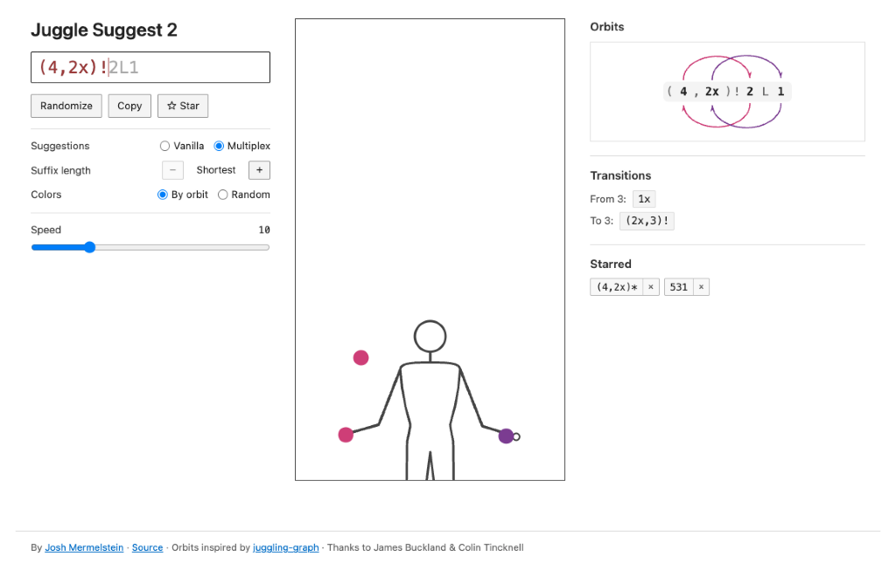

# juggle-suggest2

Juggle Suggest 2 is a browser tool for exploring, autocompleting, and visualizing juggling siteswaps. Try it live at **https://joshmermelstein.com/juggle-suggest2/**.

It has zero external dependencies, no build step, and includes a web app manifest + service worker so you can install it to your home screen and use it offline.



## Features

### Match-Input Autocomplete (Async, Sync, & Mixed)

Type any async, sync, or mixed JugglingLab-style siteswap prefix (vanilla or multiplex). As you type, the input box suggests the shortest valid completion—matching the style of your input:

- **Pure async** (e.g. `53`, `44`, `3[11]`) stays pure async.
- **Pure sync** (e.g. `(4,2x)`, `([44],2x)(2x,[4`) stays pure sync.
- **Mixed sync/async** unlocks automatically when you type `!`, `L`/`R`, crossing `x` on an async throw (`4x`, `3x`), an odd throw inside `(a,b)`, or mix sync and async beats—e.g. `(4,2x)!`, `531(4,`, `(2x,4)3`, `4x4x`, `(4,5x)(4,1x)!R5x41x`.
- **`*` mirror shorthand** (e.g. `(4,2x)*`, `(6x,4)*`, `4x1(4x,3x)*`) is supported whenever you type it, without ever being emitted into suggested suffixes.
- **Spaces** separate tokens when needed (e.g. `z x y` for `35, 33, 34` so `x` isn't parsed as a crossing modifier).

Press `Tab`, `Enter`, or `Right Arrow` at the end of the input to accept the suggestion.

- **Vanilla vs. Multiplex**: Vanilla avoids adding new multiplexes (while honoring an open `[` you typed); Multiplex uses them freely to keep suffixes short.
- **Suffix Length Stepper (`-` / `+`)**: Step beyond the shortest suffix to explore longer valid completions.
- **Randomize, Copy, Star, & Shareable URLs**: Re-shuffle the suffix (or generate a random siteswap via the juggling-cards model when empty), copy the completed pattern, star favorites in `localStorage`, or share the live `?prefix=...` URL directly from the address bar (updated via `history.replaceState` without polluting Back history).

### Animator

Animates the completed pattern on an HTML5 Canvas with a 3D-IK juggler, hybrid camera zoom + gravity scaling for tall patterns, perceptually distinct high-contrast colors (by orbit or per ball), and a speed slider.

### Orbits Visualizer & Ground-State Transitions

- **Orbits**: Renders an interactive SVG throw-arc diagram inspired by James Buckland's [juggling-graph](https://jbuckland.com/juggling-graph/), with multiplex bracket grouping, forward arcs above, wrap-around arcs below, per-orbit coloring synced with the animator, and hover-to-highlight on any arc.
- **Transitions**: Shows the shortest entry and exit transitions from/to the pattern's ground state (`b` for async, odd-ball sync, and mixed patterns; `(b,b)` for even-ball pure sync patterns), or notes when a pattern is already in ground state.

## Local Development & Tests

The app uses native ES modules with zero build step and zero runtime dependencies.

- **Run locally** (ES modules require HTTP rather than `file://`):
  ```sh
  python3 -m http.server 8000
  ```
- **Run tests** (requires Node 18+):
  ```sh
  npm test
  ```
